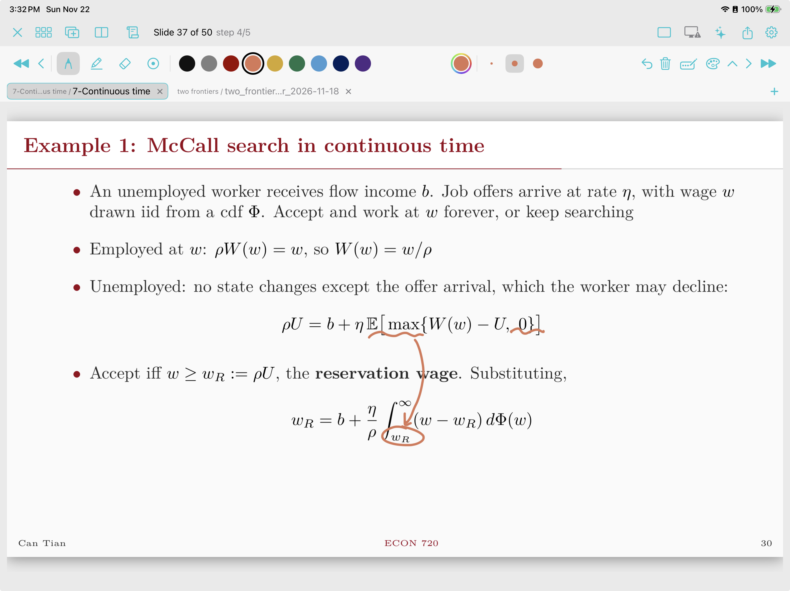
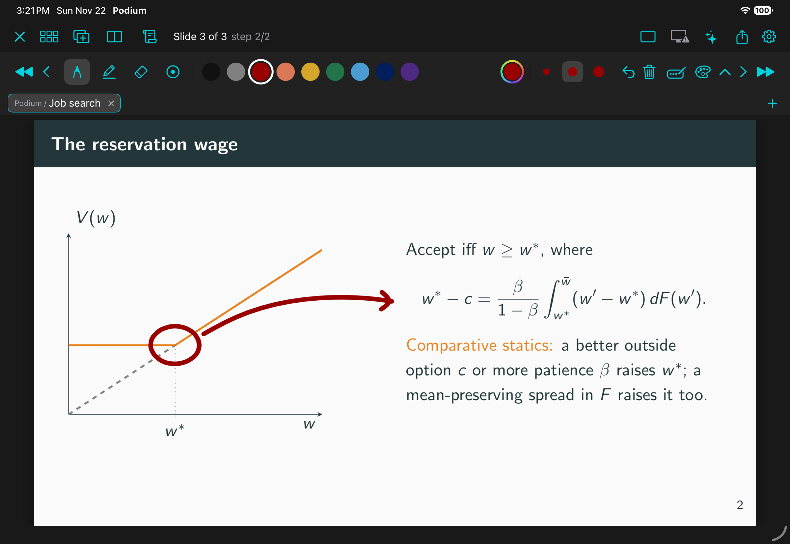
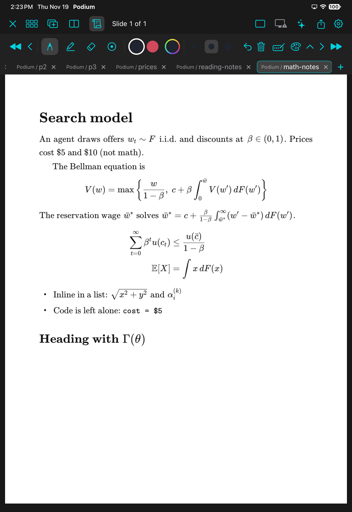

# Podium

An iPad app for presenting and reading PDFs, made for LaTeX Beamer talks and papers. It has ink that matches your slides, better pointers, and a projector view that shows only the slide.

Try it with the sample deck in `examples/job-search.pdf` (source: `job-search.tex`).

## Features

### Presenting
- **Beamer-aware slides.** Overlay steps (`\pause`, `\only`) are grouped into one slide. The counter reads "Slide 5 of 32, step 2/4", the grid shows slides rather than steps, and ink stays on a slide while its steps reveal more.
- **Projector view.** With an external display or AirPlay, the room sees only the slide, ink and pointer. The iPad keeps the controls, a timer and a preview of the next step. Black out the projector with one tap or the B key.
- **Clickers and keyboards.** Arrow, space and page up/down keys work. Apple Pencil double-tap or squeeze can turn pages in pointer mode.
- **Links.** Hyperref links and Beamer's navigation symbols work when tapped, and a "Back to slide N" chip takes you back. Web links open in Safari.

### Pointers
- **Dot:** a glowing laser dot.
- **Trail:** a dot with a short fading tail, so the room can follow the motion.
- **Highlight:** a translucent stroke that fades after about 1.5 seconds.

The pointer follows the Pencil when it touches the screen or hovers just above it (on iPads with Pencil hover).

### Ink
- Pen (pressure, monoline or fountain), highlighter and eraser, built on PencilKit.
- Ink is saved per slide and kept when you recompile the PDF.
- Widths are set relative to the screen, so a pen looks the same in every document.
- **Palettes:** the default "Podium" palette (black, grey, Penn red, Claude orange, ochre, forest green, Carolina blue, Penn blue, Northwestern purple), three more built-in palettes, and one generated from each deck's own theme colours. You can add custom colours with the system picker; its eyedropper samples anything on screen.
- **Extras:** a whiteboard, note margins beside the page, and blank or photo pages inserted between slides.
- **Export:** an annotated PDF with your ink.

### Reading
- **Scroll mode** with pinch zoom.
- **Side by side:** two documents at once, for example the slides and the paper.
- **Tabs:** they're remembered between launches. Hold and drag to reorder them, or drop one onto the page to open it side by side.
- **Text selection:** hold a finger on text, then drag. Copy, highlight or look up the selection.
- **Markdown files:** rendered like a LaTeX paper.
  - Computer Modern type on US Letter pages at 11 pt.
  - Math typeset by KaTeX (bundled, works offline).
  - Tables in booktabs style that break across pages.
- Plain text and image files open too.

### Files
- Link a folder (iCloud Drive, Dropbox, …) or add single files. Podium reads the originals, so a recompiled PDF shows up as soon as it syncs.
- An optional `.podium` file beside each PDF keeps its ink and notes, so they sync to your other devices.
- **Manage Storage** shows what Podium keeps and can clean up old notes automatically.

### Assistant (optional)
- A side panel for questions about the deck.
- Generates speaker notes for each slide, which you can edit.
- Bring your own API key: Claude, or any OpenAI-compatible provider (OpenAI, Gemini, OpenRouter, …).
  - You can save several named connections and switch between them.
  - Keys are stored only in the iPad's Keychain. They never leave the device except in requests to the provider you chose.

## Requirements and installing

Podium is an iPadOS 17+ app distributed as source: a Swift Playgrounds app package, `Podium.swiftpm`.

**With a Mac and Xcode (recommended):**
1. Open `Podium.swiftpm` in Xcode.
2. In `Package.swift`, change `teamIdentifier` to your own Apple developer team ID and `bundleIdentifier` to something unique, such as `com.yourname.podium`. You can also pick your team under Signing & Capabilities.
3. Connect the iPad, choose it as the run destination, and press ▶.

A free Apple ID works, but the app expires after 7 days and has to be reinstalled. A paid developer account makes the install last a year.

**On the iPad alone:** copy `Podium.swiftpm` to the iPad, open it in Swift Playgrounds, and press Run. Projector output may just mirror the screen in this mode.

## Credits

- [KaTeX](https://katex.org) 0.19.1 (MIT licence) is bundled for math typesetting. Its fonts also set the Markdown text.
- Built with Claude.

## Licence

MIT (see `LICENSE`). KaTeX is MIT-licensed as well; its licence is reproduced in `Podium.swiftpm/KaTeXAssets.swift`.
